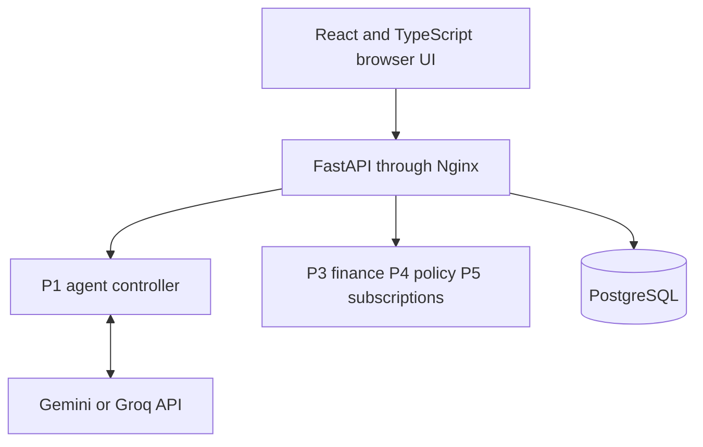
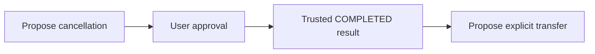
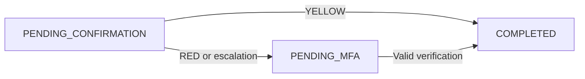

# bank.ly Technical Documentation

**帮客力 | Banking AI Agent | Hackathon submission**

**Document version:** 1.0. **Review date:** 29 October 2026. **Implementation snapshot:** repository commit `961ccee` on `feature/agent`. **Shared contracts:** 1.0.0.

## 1 Project overview

bank.ly is a conversational banking prototype that turns natural-language requests into validated banking proposals and grounded replies. It covers spending analysis, transfers by verified recipient name, and recurring-payment detection with simulated subscription cancellation. All accounts, transactions and execution effects are synthetic. No live bank, payment network or merchant cancellation service is connected.

The application combines language-model interpretation with deterministic financial calculations and server-controlled authorization. Gemini or Groq extracts a structured intent. Python validates the extracted details, maintains an unfinished draft and constructs canonical tool proposals. The backend supplies account context, retrieves data, applies permission tiers and executes approved simulator operations. The model never receives authority to execute a transfer or cancellation.

| Capability | Implemented scope |
| --- | --- |
| Balance queries | Automatic lookup of the selected demo account, with a reply grounded in its database record. |
| Spending analysis | Monthly debit totals, category breakdowns and explainable anomaly flags. |
| Smart transfers | Named verified recipients, amount clarification, corrections and explicit approval; simulated MFA when required. |
| Subscription management | Recurring-charge candidates, stored-record eligibility and confirmed simulated cancellation. |
| Ordered tasks | A fixed cancellation-then-transfer dependency plan, with a separate approval for each action. |
| Conversation experience | Persistent chat history, separate chats, working memory, draft corrections and interruption. |

This document explains the current implementation rather than claiming every example in the challenge brief is complete. Sections 2-3 describe the system; Sections 4-7 explain the algorithms; Sections 8-9 cover security; Sections 10-12 cover persistence, reproducibility, verification and remaining limitations.

**Design invariant:** understanding a request, proposing an action, approving it and confirming its completion are separate steps.

<!-- pagebreak -->

## 2 System architecture

The FastAPI backend is the composition root. It is the only application layer that coordinates database access and financial execution. The agent, finance, policy and subscription packages expose typed interfaces and can be tested independently against shared contracts.



| Layer | Responsibility |
| --- | --- |
| React and TypeScript | Chat, saved conversations, account views, transaction views, subscription views and approval or MFA controls. |
| Nginx and FastAPI | Serve the frontend, proxy `/api/v1`, resolve demo identity and coordinate controlled operations. |
| Agent package P1 | Intent extraction, input grounding, clarification state, bounded planning and user-facing replies. |
| Finance P3 | Exact spending aggregation, categorization and rule-based anomaly detection. |
| Security P4 | Pure fail-closed policy decisions; P2 persists and enforces their outcomes. |
| Subscriptions P5 | Pure recurrence detection, candidate mapping and cancellation eligibility. |
| SQLAlchemy and PostgreSQL | Accounts, ledger entries, stored subscriptions, approvals, audits, conversation state and transcripts. |

The external model receives the request text, instructions and output schema. Account selection, recipient IDs, subscription state and tool-result validation are handled in application code. Financial reports are formatted locally rather than sent to an LLM to calculate or invent values.

Docker Compose runs frontend, backend and PostgreSQL services. SQLite supports local development and disposable tests. Independent mock adapters support module development, while the real agent also has a deterministic mock *interpretation provider*.

**Implementation:** `backend/app/services/adapters.py`, `backend/app/api/chat.py`, `frontend/src/App.tsx`, `docker-compose.yml`, `infra/`.

<!-- pagebreak -->

## 3 Shared contracts and controlled tools

Shared Pydantic v2 models define the module boundaries. Unexpected fields are forbidden, IDs are bounded strings and transaction timestamps must include a timezone. Money uses Python `Decimal`; canonical monetary JSON values are strings. Positive transfer amounts have at most two decimal places. Versioned executable contracts take precedence over preliminary interface examples.

| Tool | Required arguments | Execution category |
| --- | --- | --- |
| `get_balance` | `account_id` | Read only |
| `analyze_spending` | `account_id`, `period` as `YYYY-MM` | Read only |
| `list_subscriptions` | `account_id` | Read only |
| `request_transfer` | `source_account_id`, `recipient_id`, `amount`, `currency` | Approval required |
| `request_subscription_cancel` | `subscription_id` | Approval required |

The backend constructs catalog entries shaped as `{name, parameters, context}`. Argument schemas come from `TOOL_ARGUMENT_MODELS`; trusted context supplies the selected account, verified recipients, stored subscriptions and conversation state. This is an application catalog, not a grant of native SDK tool-execution authority to the model.

The public P1 entry point is unchanged:

```python
process_message(chat: ChatInput, tool_catalog: list[dict],
                tool_results: list[dict] | None = None) -> AgentResult
```

`AgentResult` contains `reply`, `proposals` and `needs_clarification`. The additional `process_turn` helper returns the result plus caller-owned state. A transfer proposal contains only canonical financial arguments:

```json
{
  "proposal_id": "proposal_example",
  "tool": "request_transfer",
  "arguments": {
    "source_account_id": "acc_cny_001",
    "recipient_id": "usr_bob_01",
    "amount": "300.00",
    "currency": "CNY"
  }
}
```

The server separately issues an `action_id`, digest, tier and current status under sibling approval metadata. These fields are not injected into canonical tool arguments. `proposal_id` identifies the agent proposal; `action_id` identifies the stored approval ticket.

**Implementation:** `contracts/models.py`, `contracts/tool_schemas.py`, `contracts/enums.py`, `backend/app/api/schemas.py`.

<!-- pagebreak -->

## 4 Intent understanding and conversation recovery

### Interpretation pipeline

1. Validate the request and the caller-supplied conversation state, including its conversation ID. Reject inconsistent context snapshots.
2. Process trusted tool results before ordinary language interpretation. Handle supported plan controls and whole-message draft abandonment locally.
3. Use deterministic shortcuts for recognized simple messages and exact clarification answers. Other requests go through the configured provider.
4. Validate the provider JSON against a private `Intent` model. Supported intents are balance, spending, subscriptions, transfer, cancel and unknown.
5. Ground extracted amounts and names in the user's request. Resolve names only against verified context; never silently repair an identity or invent a missing value.
6. Either ask for missing information or construct a schema-validated proposal. Store its original canonical snapshot for later result correlation.

The LLM handles broader phrasing and ordinary command typos. Conservative request guards distinguish direct mutation requests from quoted, hypothetical, negated or merchant-reported instructions. Typo normalization applies to request wording, not recipient identities, amounts or dates. Unknown input prompts clarification without proposing an operation.

### Working memory and corrections

An unfinished transfer retains its original request, account, amount and recipient details. Spending drafts retain supplied month and year separately. A named month without a year asks for the year; a year alone asks for the month. Application parsing uses stated dates and ignores a model-invented year.

```text
User: Transfer to vov
Agent: Asks for an amount
User: 300
Agent: Cannot find vov in the verified recipient list
User: Oh wait I meant Bob
Agent: Proposes CNY 300.00 to the uniquely matched verified Bob
```

Explicit corrections such as "actually, 50 instead" update an unfinished draft and preserve unrelated details. Invalid replacement amounts do not silently reuse an old amount. Natural stopping phrases discard a draft; existing approval cards remain unchanged. Once issued, a proposal cannot be rewritten through a draft correction.

### Provider behavior

Gemini and Groq share the same validated intent boundary. Groq requests strict JSON schema output and low reasoning effort. Connections are reused per worker thread; request timeouts are bounded and automatic provider retries or fallback are not enabled. Provider failure returns a categorized safe reply and no new proposal. Tone cues affect wording only, never authorization.

**Implementation:** `agent/service.py`, `agent/request_guard.py`, `agent/conversation.py`, `agent/provider.py`, `agent/prompts.py`, provider adapters.

<!-- pagebreak -->

## 5 Grounded replies and ordered task planning

### Read tool round trip

For a balance, spending or subscription query, the agent first proposes a read tool. The backend validates policy and account scope, runs the database query or deterministic calculation, and supplies a result envelope back to the agent. The envelope includes `conversation_id`, `proposal_id`, `tool`, `arguments`, `status` and typed `data`.

The agent requires the conversation, proposal, tool and canonical arguments to match the saved pending request. A balance must refer to the requested account; a report must refer to the requested month. Uncorrelated, altered or malformed results cannot establish success. Accepted read results consume the pending snapshot. Accepted terminal execution results are consumed; pending confirmation or MFA outcomes retain it for a later update.

### Bounded dependency graph

The current planner supports two ordered nodes with one dependency edge. It is implemented as an explicit state machine, not arbitrary LLM-generated plans.



For example, "Cancel iQIYI VIP Monthly then transfer 45 CNY to Bob" starts with cancellation only. The transfer is proposed only after the backend verifies cancellation completion. The amount and recipient must be supplied explicitly; cancellation does not credit money to the account or establish that savings have already been received. Each action needs its own approval and fresh policy check.

| Event | Planner behavior |
| --- | --- |
| Missing details | Retain the current step and ask for clarification. |
| Pending confirmation or MFA | Wait for a trusted update; do not release the dependent step. |
| Completed cancellation | Propose the specified transfer, subject to validation and approval. |
| Failed, rejected or cancelled action | Stop dependent work. |
| Pause or human takeover wording | Pause the plan and direct the user to the app team; no automatic human assignment occurs. |
| Stop plan | Remove unfinished steps, preserve issued approvals and do not reverse completed actions. |

Continuation responses are cached against stored actions. Missed callbacks can be recovered on a later chat request. This is execution-result recovery, not permission to repeat a financial operation.

**Implementation:** `agent/planning.py`, `agent/service.py`, `backend/app/api/chat.py`, `backend/app/api/continuation.py`.

<!-- pagebreak -->

## 6 Spending analysis algorithm

The finance module is a deterministic pure calculation. The backend passes the selected account's transaction records; the finance function performs no database writes, HTTP calls or model inference. Months use Asia/Shanghai calendar boundaries, including when stored UTC timestamps fall near midnight.

### Cleaning and aggregation

Identical repeated transaction IDs are counted once. Conflicting records sharing an ID are excluded and flagged. Defensive amount and timestamp checks exclude malformed records. Existing informative category labels are preserved, normalized and grouped case-insensitively; missing categories use ordered merchant rules, then `Uncategorized`.

```text
Spending(month) = sum(valid debit amounts in that month)
CategoryTotal(category) = sum(valid debits in that category)
Spending(month) = sum(all category totals)
```

Credits, including income, inbound transfers and refund credits, are excluded. Refunds do not reduce gross spending. Outbound transfers count as spending by default. Decimal arithmetic and cent formatting are used throughout; financial totals do not depend on language-model arithmetic.

### Explainable anomaly rules

| Rule | Default trigger |
| --- | --- |
| Unusually large debit | With at least 3 category-history debits, amount is greater than 3 times their median and at least CNY 100 above it. |
| Large debit with little history | With insufficient category history, amount is at least CNY 2,000. |
| Category monthly spike | With the required 3-month history coverage and at least 2 active prior months, current total exceeds 1.5 times the prior monthly mean and is at least CNY 200 above it. |
| Possible duplicate charge | Same account, normalized merchant and amount within 600 seconds, with distinct transaction IDs. Both charges remain counted. |

Each returned anomaly refers to a transaction ID and a stable reason code with an explanation. Flags are review signals, not proof of fraud. Richer informational diagnostics, such as excluded credits, are available separately and are not automatically fields in the shared report DTO.

The frozen October 2026 fixture produces total spending of **CNY 1,843.00**, with Shopping 1,200.00, Food 360.00, Transport 125.00, Education 80.00, Subscriptions 58.00 and Other 20.00; it has no anomaly flags. This fixture result must not be confused with the mutable application's seeded database, whose reports change after demo transfers.

The agent formats validated report values and known reason codes locally. Untrusted free-text anomaly instructions are not forwarded as commands or used to invent merchant details.

**Implementation:** `finance/analytics.py`, `finance/cleaning.py`, `finance/categories.py`, `finance/anomalies.py`, `finance/money.py`.

<!-- pagebreak -->

## 7 Recurring payments and cancellation eligibility

The subscription detector operates on the selected account's debits. It removes duplicate IDs and identical posted charges, groups normalized merchant names, clusters similar amounts and checks the gaps between consecutive charges. Transaction notes are not read by the detector.

### Detection rules

At least two charges are needed. Amounts in one cluster must stay within 1.05 times its minimum. Every consecutive gap in that cluster must fall within one supported cadence window. The estimated payment is the median amount, rounded to cents.

| Cadence | Consecutive gap window |
| --- | --- |
| Weekly | 6 to 8 days |
| Monthly | 27 to 33 days |
| Annual | 360 to 370 days |

Confidence is a rule-based evidence score: 0.40 for two matching charges, 0.70 for three, 0.85 for four and 0.90 for five or more. Varying amounts reduce it by 0.10. This score is not a calibrated probability or authorization decision. A candidate includes its evidence transaction IDs, cadence and estimated amount. The detector itself always sets cancellation support to false because transactions cannot establish merchant support.

### Stored records govern cancellation

Candidate mapping first restricts stored subscriptions to the resolved user. A matching ID must also have a matching normalized merchant; otherwise merchant matching is used, with price disambiguation when needed. Missing or ambiguous matches are refused. The stored record must be active and support cancellation. Candidate confidence never bypasses these checks.

| Example stage | Synthetic iQIYI example |
| --- | --- |
| Evidence | Two CNY 45.00 charges, 30 days apart. |
| Detected candidate | Monthly, estimated CNY 45.00, confidence 0.40. |
| Verified stored record | `sub_iQIYI_01`, active and cancellation supported. |
| Proposed action | Uses the stored ID and requires explicit confirmation. |
| Successful simulator execution | Marks the owned stored record cancelled and writes an audit; balance is unchanged. |

Detection candidates and verified subscriptions are deliberately separate. A user may also request cancellation of an eligible stored subscription without sufficient recurring evidence. Repeated cancellation cannot re-execute an already-cancelled record. No merchant API is contacted, and no refund or immediate savings credit is generated. Renewal reminders and scheduled notifications are not implemented.

**Implementation:** `subscriptions/detector.py`, `subscriptions/mapping.py`, `subscriptions/eligibility.py`, `backend/app/services/subscriptions.py`, `backend/app/services/executor.py`.

<!-- pagebreak -->

## 8 Permission tiers and execution safety

The policy engine is a pure, fail-closed function over a typed proposal and backend-resolved context. Invalid objects, unknown tools, invalid arguments, account mismatch and locked-account mutations are denied. A RED classification can therefore mean either an allowed action requiring MFA or a denied action; `allowed_to_proceed` must always be checked.

| Tier | Current tool scope | Required user interaction |
| --- | --- | --- |
| GREEN | Balance, spending and recurring-payment reads | Automatic after validation and account scoping. |
| YELLOW | Subscription cancellation; transfers where completed daily total plus requested amount is at most CNY 1,000 | Explicit confirmation of the exact proposal. |
| RED | Transfers where that cumulative total exceeds CNY 1,000 | Confirmation followed by simulated MFA. |



### Payload binding and fresh authorization

The server stores canonical financial arguments and computes SHA-256 over the tool and sorted payload JSON. Confirmation must refer to the owned ticket and its stored digest. The digest binds the approved payload; it is not a digital signature or a substitute for authentication. Arguments and approval metadata remain separate in HTTP responses.

At execution time the backend revalidates arguments, ownership, lock state, subscription eligibility and current daily transfer totals. A stale YELLOW request can escalate to RED after another completed transfer. A previously RED ticket is not downgraded. The daily counter uses Asia/Shanghai dates and rolls forward under the execution guard.

### Concurrency and idempotent replay

The shared guard acquires database protection in user, action and account order. PostgreSQL row protection and SQLite writer serialization keep fresh policy checks, sufficient-funds checks, balance updates, ledger writes, audit writes and terminal status in the controlled transaction. Execution failures roll back partial financial writes.

Repeated confirmation or verification of a completed ticket returns its stored outcome without executing it again. This guarantee is tied to the server-issued action and its state; it is not a global deduplication guarantee across independently created tickets or arbitrary client keys.

The transfer simulator debits the source account and creates an outgoing ledger record. It does not settle funds to a recipient's real bank account. Stopping a draft is different from revoking an approval, and neither reverses a completed transfer.

**Implementation:** `security/policy.py`, `security/rules.py`, `backend/app/services/actions.py`, `action_execution.py`, `daily_transfers.py`, `executor.py`, `backend/app/api/approvals.py`.

<!-- pagebreak -->

## 9 MFA safety locks and threat controls

### Simulated strong verification

RED-tier confirmation issues a random six-digit code bound to the action record and its owner. The challenge lasts up to five minutes and cannot outlive the ten-minute approval ticket. Three failed attempts are allowed. Expired, consumed or unissued challenges cannot authorize execution. Successful verification claims the challenge conditionally within the guarded execution transaction.

Delivery is explicitly simulated: the backend console and the resolved user's demo inbox display the code. No SMS or email is sent. Because the same demo interface exposes the code, this is not an independent production authentication factor. Plaintext OTP storage and console delivery must be replaced before real use.

### Persistent safety locks

Three wrong OTPs or tampered confirmation digests within a fifteen-minute observation window trigger a user safety lock. Other pending approvals are retired, transfers and cancellations are blocked, and reads remain available. The lock survives restarts and does not expire automatically. A local operator reset requires a review reason and writes an audit; there is no agent-accessible unlock tool.

| Threat | Implemented control |
| --- | --- |
| Invented banking results | Match tool results to saved proposals, canonical arguments, account and month before displaying figures or completion. |
| Prompt injection | Treat merchant and note text as data; validate output; whitelist tools; suppress suspicious display text; never execute generated code. |
| Changed payload or wrong account | Resolve demo identity server-side, scope records to that identity, validate exact arguments and compare the stored digest. |
| Repeated or racing execution | Database guard, conditional challenge consumption, terminal-state checks and atomic financial writes. |
| Provider outage or malformed output | Categorized failure responses, bounded requests and no new proposal on failure. |
| Repeated verification abuse | Challenge attempt limits, cross-action failure counting and persistent safety locks. |

Audit records cover execution, MFA issuance, escalation, observed action status, policy rejections, daily-counter resets, approval cancellation and safety-lock events. The user-facing audit API exposes event metadata rather than raw internal details. Records use ordinary database storage; the prototype does not provide cryptographic tamper-evident logs or comprehensive capture of every model decision and read.

Provider error logs use a random event ID, stage, safe category and optional HTTP code. This redaction does not extend to the deliberately simulated OTP console or all legacy backend and policy logging paths; those require hardening before processing sensitive data.

**Implementation:** `backend/app/services/mfa.py`, `safety_lock.py`, `backend/app/api/approvals.py`, `demo_inbox.py`, `audit.py`, `agent/service.py`.

<!-- pagebreak -->

## 10 Persistence history and API design

SQLAlchemy models separate financial state, authorization records, working memory and the visible transcript. The default Docker deployment stores PostgreSQL data in the persistent `pgdata` volume. Alembic migrations are applied before the seed routine starts the backend; existing balances and ledger data are preserved.

| Database table | Stored responsibility |
| --- | --- |
| `users` and `accounts` | Demo identities, balances, transfer-day counters and safety-lock state. |
| `transactions` | Debit or credit ledger records and their categories. |
| `subscriptions` | Owned stored subscriptions, status and cancellation support. |
| `action_approvals` | Canonical payload, digest, tier, status, expiry, MFA lifecycle and continuation correlation. |
| `audit_logs` | Action and security event records with audit IDs. |
| `agent_conversations` | User-scoped conversation ID, title, timestamps and agent working-state JSON. |
| `chat_messages` | Ordered user and agent messages, saved response data and unique continuation-event keys. |

Working memory is distinct from visible history. The backend restores the selected conversation's draft state between turns. The frontend loads messages from server endpoints and stores only the selected conversation ID in browser storage. Full historic transcripts are not automatically sent as model context.

History reads restore approval cards from owned server tickets, verify their original arguments and digest, and use current ticket status. They do not invoke the model, create proposals, confirm approvals or execute operations. Continuation event keys prevent duplicate stored follow-up messages on repeated delivery. Message history is paginated and separate conversations do not share draft details.

| API group | Current endpoints under `/api/v1` |
| --- | --- |
| Conversation | `POST /chat`, `POST /conversations`, `GET /conversations`, `GET /conversations/{id}` |
| Account data | `GET /accounts`, `GET /transactions`, `GET /subscriptions`, `GET /subscriptions/records` |
| Approval lifecycle | `GET /actions/{id}`; `POST /actions/{id}/confirm`, `/verify`, `/cancel`, `/continue` |
| Operational views | `GET /audit`, `GET /demo/otp-inbox`, `GET /health` |

The current identity mechanism is a demo header with a configured fallback user, not a login/session system. Ownership checks use the resolved demo identity but do not prevent a caller from selecting another known demo identity. Chat content, approvals and audit details are stored without application-layer encryption; retention and deletion controls are not yet implemented. Earlier messages that were never stored cannot be recovered retroactively.

**Implementation:** `backend/app/db/models.py`, `backend/migrations/`, `session_store.py`, `chat_history.py`, `backend/app/api/conversations.py`, `frontend/src/App.tsx`, `frontend/src/api.ts`.

<!-- pagebreak -->

## 11 Reproduction and verification

### Local demonstration

Use Docker Compose with the repository's three services. Configure a provider key privately in the launching terminal; never put it in frontend code, screenshots or committed files. For a Groq demonstration:

```powershell
$env:USE_MOCK_AGENT = 'false'
$env:USE_MOCK_SECURITY = 'false'
$env:USE_MOCK_SUBSCRIPTIONS = 'false'
$env:AGENT_PROVIDER = 'groq'
$env:GROQ_MODEL = 'openai/gpt-oss-20b'
# Set GROQ_API_KEY privately in this terminal first
docker compose up -d --build
```

The website is available at `http://localhost:3000` and API documentation at `http://localhost:8000/docs`. Gemini is selectable through `AGENT_PROVIDER=gemini`, `GEMINI_API_KEY` and `GEMINI_MODEL`. Model availability is provider-dependent; configure an accessible model explicitly. Default provider requests time out after 20 seconds, configurable within 1-60 seconds.

For an offline demonstration, keep `USE_MOCK_AGENT=false` and set `AGENT_PROVIDER=mock`. This runs the actual P1 agent with deterministic interpretation and the normal backend, finance and security flow. Setting `USE_MOCK_AGENT=true` selects a different backend stub and is not equivalent. The standalone agent CLI uses synthetic fixture tools rather than the website database.

### Verification snapshot on 29 October 2026

| Check | Observed result |
| --- | --- |
| Combined Python suite | 987 passed, 22 skipped; one upstream Gemini SDK Pydantic deprecation warning. |
| Frontend component and API tests | 21 passed. |
| TypeScript and Vite production build | Passed. |
| Prior isolated browser rehearsal | Refresh preserved transcript and draft; New chat isolated memory; reopening restored one card without moving money; mobile history navigation worked. |

The combined Python command uses the repository's installed test environment:

```powershell
$env:PYTHONPATH = 'backend;.'
python -m pytest -p no:cacheprovider `
  backend/tests agent/tests finance/tests security/tests `
  subscriptions/tests tests/test_contracts.py -q
```

Frontend checks are `npm run build` and `npm test` from `frontend/`. The 22 skipped cases require an explicitly configured disposable PostgreSQL test environment (`MIGRATION_TEST_POSTGRES_ADMIN_URL`); they are not claimed as passing PostgreSQL concurrency or migration evidence. Automated model tests use synthetic responses or offline providers. This run does not measure live model accuracy, network reliability or production latency.

**Test locations:** `agent/tests/`, `backend/tests/`, `finance/tests/`, `security/tests/`, `subscriptions/tests/`, `tests/test_contracts.py`, `frontend/tests/`.

<!-- pagebreak -->

## 12 Scope boundaries and remaining risks

The prototype demonstrates the three selected banking scenarios and the Green, Yellow and Red approval model using synthetic data. It does not claim complete implementation of every challenge example or production banking readiness.

| Challenge area | Current boundary |
| --- | --- |
| Smart transfers | Verified demo recipient names are supported; phone-number lookup, scheduled transfers and split-bill collection are not. The recipient directory is demo context, not a complete customer address book. |
| Bill analysis | Monthly reports and rule-based flags are supported. A full annual-report interaction is not exposed through the current agent tools. |
| Subscriptions | Detection and simulated cancellation are supported. Renewal reminders, scheduled notifications and real merchant integrations are absent. |
| Wealth and cards | Investment operations and card-management tools are outside this implementation. |
| General task planning | The fixed two-node graph is implemented. Arbitrary DAG generation, birthday scheduling and third-party purchasing are not. |
| Rollback and takeover | Failed financial writes are rolled back. Completed business actions have no automatic compensation; human-takeover wording pauses a plan but does not assign an operator. |
| Generated-code sandbox | No generated code is executed; operations use a fixed whitelist. A restricted, monitored arbitrary-code sandbox has not been implemented. |
| Security and operations | Demo identity, simulated MFA, default development database credentials and permissive development CORS remain. TLS termination, real authentication, independent MFA delivery, secret management, comprehensive audit coverage and production rate limits require deployment hardening. |

Before any real-customer or public deployment, the team would need verified authentication and authorization, protected storage and retention controls, production database and PostgreSQL concurrency validation, independent verification delivery, controlled operations access and real banking or merchant integration agreements. These are future requirements, not properties established by the current demo.

### Implementation evidence and interpretation

The challenge brief is the user-supplied **Banking AI Agent** AI-track document. The original team-interface specification describes the initial engineering baseline; `README.md` and executable contracts record later corrections. This documentation resolves differences using the inspected code and fresh test results, rather than repeating historical milestone assertions.

For review, the main source groups are `agent/` for interpretation and planning; `backend/app/api/` and `backend/app/services/` for orchestration and execution; `backend/app/db/` and `backend/migrations/` for persistence; `finance/`, `security/` and `subscriptions/` for deterministic domain logic; and `frontend/` plus `infra/` for presentation and local deployment. Module documentation under `docs/` supplies additional rationale, but older test counts and historical vulnerability descriptions may refer to earlier revisions.

**Submission statement:** bank.ly combines existing language-model APIs with our typed agent controller, deterministic financial algorithms, persistent state and guarded simulator execution. The project uses existing models for interpretation; it does not claim to have trained a foundation model or implemented a live banking service.
