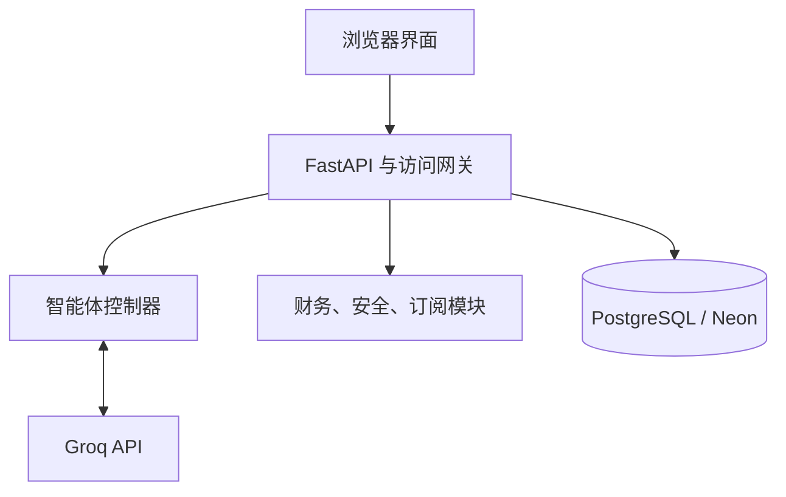
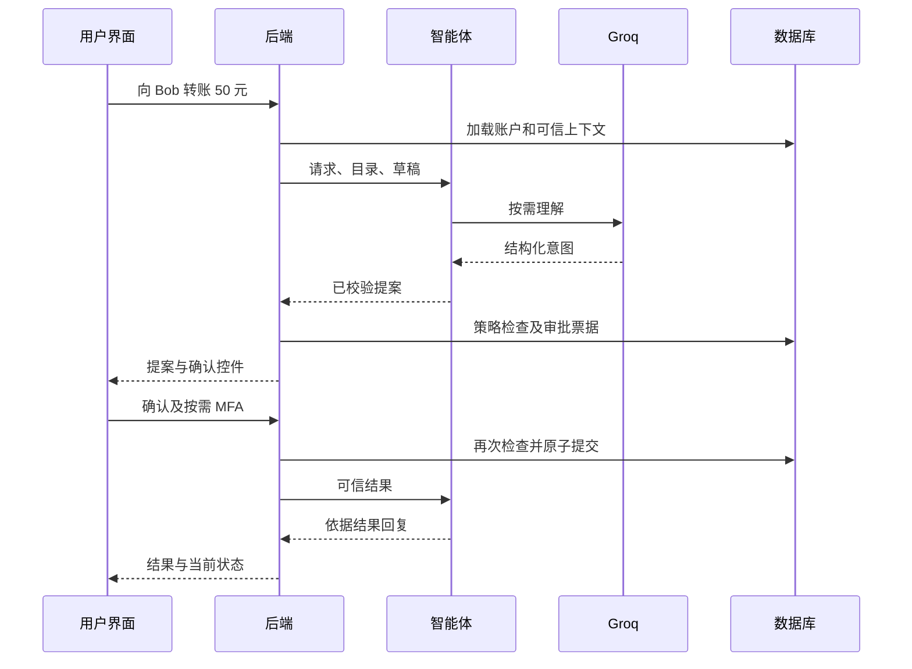
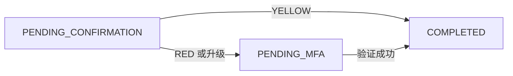

# bank.ly 帮客力

技术文档

2026 深圳国际金融科技大赛（FinTechathon）

人工智能赛道

Team SKS

GitHub 仓库：[github.com/fvia88/ai-banking-agent](https://github.com/fvia88/ai-banking-agent)

## 1 项目概述

传统手机银行操作往往需要切换多个页面、重复填写信息。bank.ly 将银行任务整合到一个对话界面，并对改变资金或订阅状态的操作保留明确授权。项目展示智能转账、支出分析和订阅管理三个场景。

系统将自然语言转换为经过校验的提案，并依据可信工具结果回复。所有账户、交易和执行效果均为模拟，未接入真实银行、支付网络或商户取消服务。

Groq 负责语言理解；应用代码校验输出、确定性计算财务数据，后端负责执行。模型没有直接转账或取消订阅的权限。

### 核心技术设计

1. **从意图到受控操作：** 类型化提案和关联工具结果将语言理解、可信事实与执行分离。
2. **可恢复对话与依赖任务：** 持久化草稿支持信息补充、纠正和中断；有界的“先取消，再转账”计划只在可信完成结果后推进。
3. **受保护的模拟执行：** 权限分级、操作绑定确认、模拟 MFA、持久化锁和数据库事务保护状态变更。

本项目属于现有模型 API 上的应用工程，不声称训练了新的基础模型。

| 功能 | 已实现范围 |
| --- | --- |
| 支出分析 | 月度借记汇总、分类明细、可解释异常标记。 |
| 智能转账 | 已验证收款人、金额澄清、纠正、明确确认及必要的模拟 MFA。 |
| 订阅管理 | 周期扣款候选、已存订阅资格校验及模拟取消。 |

第2-3节介绍系统与接口，第4-7节说明算法，第8-9节介绍安全设计，第10-11节说明持久化、部署和验证。

**设计原则：** 理解请求、提出操作、批准操作和确认完成是独立步骤。本文描述当前实现，不代表完成了赛题的所有示例。

<!-- pagebreak -->

## 2 系统架构

FastAPI 后端组装各模块，协调数据库访问与财务执行。智能体、财务、安全策略和订阅模块采用类型化接口，可依据共享契约独立测试。



| 层次 | 职责 |
| --- | --- |
| React 与 TypeScript | 对话、历史、账户、交易、订阅视图及确认和 MFA 控件。 |
| Web 服务与 FastAPI | 本地 Nginx 提供前端并代理 `/api/v1`；Render 上由 FastAPI 网关提供前端并保护 API。后端协调受控操作。 |
| 智能体控制器 | 意图提取、输入依据校验、澄清状态、有界规划及回复。 |
| 财务模块 | 精确支出汇总、分类与规则异常检测。 |
| 安全策略模块 | 以纯函数作默认拒绝的判断，由后端保存及强制执行。 |
| 订阅模块 | 周期检测、候选映射与取消资格判断。 |
| SQLAlchemy 与 PostgreSQL | 保存账户、账本、订阅、审批、审计和对话状态。 |

外部模型接收请求、指令和输出结构。账户选择、收款人 ID、订阅状态及结果校验由应用代码处理。报告在本地格式化，不由模型计算或编造金额。

本地 Docker Compose 分别运行前端、后端和 PostgreSQL。共享部署在 Render 的同一个 Docker 服务中运行前端与 FastAPI，Neon 提供持久化 PostgreSQL，Groq 提供理解。Render 提供 HTTPS，凭据通过私有环境变量配置。SQLite 用于本地和临时测试；独立模拟适配器用于开发，真实智能体也支持确定性的离线模拟意图提供器。

**实现位置：** `backend/app/services/adapters.py`、`backend/app/api/chat.py`、`frontend/src/App.tsx`、`docker-compose.yml`、`infra/`。

<!-- pagebreak -->

### 请求生命周期：经批准的转账

以“向 Bob 转账 50 元”为例，后端确定账户及已验证收款人；智能体理解并生成提案，批准和执行由后端负责。



**批准前：** 余额不变。票据绑定具体工具和财务参数，新消息不自动授权旧票据。

**执行时：** 再次检查归属、安全锁、余额和日累计；累计超过 1,000 元须模拟强验证。重复确认同一已完成票据不会再次扣款。

**执行后：** 智能体仅根据可信关联结果报告完成。理解超时不生成新提案；执行失败回滚部分财务写入。

简单请求可本地处理，因此不一定调用模型。查询不需要审批，后端执行获准读取并返回结果。所有财务效果均为模拟。

**实现位置：** `backend/app/api/chat.py`、`approvals.py`、`continuation.py`、`backend/app/services/action_execution.py`、`agent/service.py`。

<!-- pagebreak -->

## 3 共享契约与受控工具

Pydantic v2 模型定义边界，禁止额外字段、限制 ID 长度，时间戳必须带时区。金额使用 `Decimal`，JSON 标准金额为字符串；转账正数最多两位小数。可执行契约优先于早期接口示例。

| 工具 | 必需参数 | 执行类别 |
| --- | --- | --- |
| `get_balance` | `account_id` | 只读 |
| `analyze_spending` | `account_id`、`period`（`YYYY-MM`） | 只读 |
| `list_subscriptions` | `account_id` | 只读 |
| `request_transfer` | `source_account_id`、`recipient_id`、`amount`、`currency` | 需要批准 |
| `request_subscription_cancel` | `subscription_id` | 需要批准 |

后端构造 `{name, parameters, context}` 目录，参数来自 `TOOL_ARGUMENT_MODELS`；可信上下文包含账户、收款人、订阅和状态。这是应用目录，不授予模型 SDK 原生执行权限。

```python
process_message(chat: ChatInput, tool_catalog: list[dict],
                tool_results: list[dict] | None = None) -> AgentResult
```

结果含 `reply`、`proposals` 和 `needs_clarification`。`process_turn` 另返回调用方保存的状态。提案示例：

```json
{
  "proposal_id": "proposal_example",
  "tool": "request_transfer",
  "arguments": {
    "source_account_id": "acc_cny_001",
    "recipient_id": "usr_bob_01",
    "amount": "300.00",
    "currency": "CNY"
  }
}
```

服务器另行生成 `action_id`、摘要、等级及状态，作为并列审批元数据，不注入工具参数。`proposal_id` 标识提案，`action_id` 标识存储的审批票据。

**实现位置：** `contracts/models.py`、`contracts/tool_schemas.py`、`contracts/enums.py`、`backend/app/api/schemas.py`。

<!-- pagebreak -->

## 4 意图理解与对话恢复

### 处理流程

1. 校验请求与调用方会话状态（含会话 ID），拒绝不一致快照。
2. 优先处理可信工具结果；本地处理已支持的计划控制与整条消息的草稿放弃请求。
3. 简单已知消息和明确澄清答案走确定性快速处理，其余交给配置的提供器。
4. 按内部 `Intent` 校验 JSON，支持余额、支出、订阅、转账、取消和未知意图。
5. 金额和姓名必须有用户原文依据，姓名仅在已验证上下文匹配，不修改身份或编造值。
6. 询问缺失信息或构造通过结构校验的提案，保存原始参数快照用于关联结果。

模型处理多样表达与普通指令拼写错误。请求守卫区分直接操作与引用、假设、否定及商户文字中的指令。拼写归一化不修改收款人身份、金额或日期。未知输入只作引导，不生成操作。

### 工作记忆与纠正

转账草稿保存原请求、账户、金额和收款人。支出分别保存月与年：只有月份则询问年份，只有年份则询问月份；应用忽略模型臆造年份。

```text
用户：转账给 vov
智能体：询问金额
用户：300
智能体：已验证名单未找到 vov
用户：等等，我指的是 Bob
智能体：提出向唯一匹配的已验证 Bob 转账 300 元
```

明确纠正可更新草稿并保留其他信息；无效新金额不会沿用旧金额。停止表达放弃草稿，不改变已发审批卡片。已发提案不能通过草稿纠正重写。

### 提供器行为

Groq 用于在线理解，模拟提供器用于离线开发，两者采用相同校验边界。Groq 请求严格 JSON Schema 和低推理强度；每工作线程复用连接，请求超时有上限，不自动重试或切换。失败返回分类提示且无新提案，语气仅影响措辞，不影响授权。

**实现位置：** `agent/service.py`、`agent/request_guard.py`、`agent/conversation.py`、`agent/provider.py`、`agent/prompts.py` 及提供器适配器。

<!-- pagebreak -->

## 5 可信回复与有序规划

### 只读工具往返

查询先生成只读提案，后端检查策略及账户范围、查询数据库或计算，再返回 `conversation_id`、`proposal_id`、`tool`、`arguments`、`status` 与类型化 `data`。

会话、提案、工具及参数须匹配保存快照；余额须对应账户，报告须对应月份。不关联、被修改或格式错误的结果不能证明成功。接受读取或终态结果后消费快照；等待确认或 MFA 时保留快照供后续更新。

### 有界依赖图

当前规划器为显式状态机，支持两个有序节点、一条依赖边，不是任意模型生成计划。


“取消 iQIYI VIP Monthly，然后向 Bob 转账 45 元”只先提出取消，可信完成后才提出转账。金额和收款人须明确给出；取消不自动入账，也不证明已收到节省资金。每项操作独立批准并重新检查。

| 事件 | 行为 |
| --- | --- |
| 信息缺失 | 保留步骤并澄清。 |
| 等待确认或 MFA | 等待可信更新，不释放依赖步骤。 |
| 取消完成 | 经校验提出指定转账，仍需批准。 |
| 失败、拒绝或撤销 | 停止依赖任务。 |
| 暂停或人工接管表达 | 暂停并引导联系团队，不自动分派人工。 |
| 停止计划 | 移除未完成步骤，保留已发审批，不逆转完成操作。 |

续接回复按操作缓存，遗漏回调可在后续聊天恢复。这是结果恢复，不允许重复执行财务操作。

**实现位置：** `agent/planning.py`、`agent/service.py`、`backend/app/api/chat.py`、`backend/app/api/continuation.py`。

<!-- pagebreak -->

## 6 支出分析算法

财务模块采用确定性纯计算。后端传入选定账户交易，函数不写数据库、不调用 HTTP 或模型。月份按 Asia/Shanghai 日历边界计算，包括临近午夜的 UTC 时间戳。

### 清洗与汇总

同 ID 完全重复只计一次；同 ID 冲突记录排除并标记。校验排除格式错误金额与时间戳。保留有效分类并归一化、不分大小写分组；缺失分类按有序商户规则处理，再归为 `Uncategorized`。

```text
月度支出 = 当月有效借记金额之和
分类支出 = 对应分类有效借记金额之和
月度支出 = 所有分类支出之和
```

收入、转入、退款等贷记排除；退款不抵减总支出，转出默认计入。使用 Decimal 和分位格式，不依赖模型算术。

| 异常规则 | 默认条件 |
| --- | --- |
| 异常大额借记 | 至少 3 笔同分类历史借记，超过中位数 3 倍且至少高出 100 元。 |
| 历史不足的大额借记 | 分类历史不足且金额至少 2,000 元。 |
| 分类月度突增 | 满足前 3 个月覆盖且至少 2 个月有活动；超过历史月均 1.5 倍且至少高出 200 元。 |
| 疑似重复扣款 | 同账户、归一化商户与金额，600 秒内不同交易 ID；两笔仍计入。 |

异常附交易 ID、稳定原因码及解释，只是复核线索而非欺诈证据。排除贷记等信息性诊断另有接口，不自动加入共享报告 DTO。

冻结的 2026 年 10 月夹具支出 **1,843.00 元**：购物 1,200.00、餐饮 360.00、交通 125.00、教育 80.00、订阅 58.00、其他 20.00，无异常。它不同于可变演示数据库，演示转账会改变应用报告。

智能体本地格式化已验证金额和已知原因码；不将不可信异常文本当指令，也不据此编造商户细节。

**实现位置：** `finance/analytics.py`、`finance/cleaning.py`、`finance/categories.py`、`finance/anomalies.py`、`finance/money.py`。

<!-- pagebreak -->

## 7 周期扣款与取消资格

检测器读取选定账户借记，移除重复 ID 和完全重复入账扣款，归一化商户、聚类相近金额并检查相邻间隔，不读取交易备注。

### 检测规则

至少两笔扣款，同簇最大金额不超过最小值 1.05 倍，每个相邻间隔须落在支持窗口；估计金额为中位数并舍入到分。

| 周期 | 间隔窗口 |
| --- | --- |
| 每周 | 6 至 8 天 |
| 每月 | 27 至 33 天 |
| 每年 | 360 至 370 天 |

规则证据分：两笔 0.40、三笔 0.70、四笔 0.85、五笔及以上 0.90；金额变化减 0.10。它不是校准概率或授权。候选含证据 ID、周期及估计金额；检测器将取消支持设为 false，因为交易不能证明商户支持取消。

### 已存记录决定取消资格

先限定当前用户订阅。ID 匹配还须商户一致，否则按商户匹配、必要时用价格消歧；缺失或歧义拒绝。记录须活动且支持取消，置信分不能绕过检查。

| 阶段 | 模拟 iQIYI 示例 |
| --- | --- |
| 证据 | 两笔 45.00 元，相隔 30 天。 |
| 候选 | 每月、估计 45.00 元、分数 0.40。 |
| 已验证记录 | `sub_iQIYI_01`，活动且可取消。 |
| 提案 | 使用已存 ID 并要求确认。 |
| 执行 | 标记所属订阅取消，写审计，余额不变。 |

候选与已验证订阅分离。用户可直接取消合格已存订阅，不必先有周期证据。已取消记录不能重复执行；不调用商户 API、不退款、不即时入账。未实现续费提醒及定时通知。

**实现位置：** `subscriptions/detector.py`、`subscriptions/mapping.py`、`subscriptions/eligibility.py`、`backend/app/services/subscriptions.py`、`backend/app/services/executor.py`。

<!-- pagebreak -->

## 8 权限分级与执行安全

策略引擎是提案与后端上下文上的默认拒绝纯函数。错误对象、未知工具、参数无效、账户不符和锁定账户变更均拒绝。RED 可表示须 MFA 或已拒绝，必须检查 `allowed_to_proceed`。

| 等级 | 当前范围 | 交互 |
| --- | --- | --- |
| GREEN | 余额、支出、周期扣款查询 | 校验范围后自动执行。 |
| YELLOW | 订阅取消；日已完成总额加本次金额不超过 1,000 元的转账 | 确认具体提案。 |
| RED | 上述累计超过 1,000 元的转账 | 确认后模拟 MFA。 |



### 参数绑定与即时授权

对工具及排序后的财务载荷 JSON 计算 SHA-256；确认须对应所属票据与已存摘要。摘要绑定批准载荷，不是签名或认证替代品。HTTP 中参数与审批元数据分开。

执行重新校验参数、归属、锁、订阅资格及日累计。旧 YELLOW 可因另一笔完成转账升级 RED，原 RED 不降级。日计数按 Asia/Shanghai 日期在执行保护内滚动。

### 并发与幂等重放

按用户、操作、账户顺序获取保护。PostgreSQL 行保护和 SQLite 写串行化将即时策略、余额检查、余额更新、账本、审计与终态放入受控事务；失败回滚部分写入。

重复确认或验证已完成票据返回已存结果，不再执行；该保证绑定服务器操作及状态，并非不同票据或任意客户端键的全局去重。

模拟器扣减源账户并生成转出账本，不向真实银行结算。停止草稿不同于撤销审批，两者都不逆转已完成转账。

**实现位置：** `security/policy.py`、`security/rules.py`、`backend/app/services/actions.py`、`action_execution.py`、`daily_transfers.py`、`executor.py`、`backend/app/api/approvals.py`。

<!-- pagebreak -->

## 9 MFA、安全锁与威胁防护

### 模拟强验证

RED 确认生成绑定操作和所有者的随机六位码，有效期最多 5 分钟且不超过 10 分钟审批票据期限，允许三次失败。过期、消费过或未签发挑战不能授权。成功验证在受保护事务内条件消费挑战。

后端控制台和用户演示收件箱显示验证码，不发送短信、邮件；同一界面可见代码，不是独立生产认证因子。真实使用前须替换明文存储和控制台发送。

### 持久化安全锁

15 分钟内三次错误 OTP 或篡改摘要触发用户锁，终止其他待审批、阻止转账和取消，保留读取。锁跨重启保留、不自动到期。本地操作员重置需复核原因并写审计，智能体无解锁工具。

| 威胁 | 控制 |
| --- | --- |
| 编造结果 | 显示前匹配提案、参数、账户和月份。 |
| 提示注入 | 商户及备注视为数据，校验输出、工具白名单、抑制可疑文本、不执行生成代码。 |
| 修改载荷或错误账户 | 服务端确定身份、限定范围、校验参数和摘要。 |
| 重复或竞态执行 | 数据库保护、条件消费挑战、终态检查和原子写入。 |
| 模型故障或格式错误 | 分类提示、请求时限、失败无新提案。 |
| 验证滥用 | 次数限制、跨操作计数和持久化锁。 |

审计记录执行、MFA 签发、升级、状态观察、策略拒绝、日计数重置、审批撤销及锁事件。用户 API 展示元数据而非内部细节。普通数据库日志不是密码学防篡改日志，也未完整记录每次模型决策及读取。

模型错误日志含随机事件 ID、阶段、安全分类及可选 HTTP 状态。脱敏不覆盖模拟 OTP 控制台和全部旧后端、策略日志，处理敏感数据前仍须加固。

**实现位置：** `backend/app/services/mfa.py`、`safety_lock.py`、`backend/app/api/approvals.py`、`demo_inbox.py`、`audit.py`、`agent/service.py`。

<!-- pagebreak -->

## 10 持久化、历史与 API

SQLAlchemy 分开存财务状态、授权、工作记忆和可见消息。本地 PostgreSQL 用持久化 `pgdata` 卷，启动迁移后种子初始化，已有余额与账本保留。

| 数据表 | 内容 |
| --- | --- |
| `users`、`accounts` | 身份、余额、转账日计数和锁。 |
| `transactions` | 借记、贷记账本及分类。 |
| `subscriptions` | 所属订阅、状态、取消支持。 |
| `action_approvals` | 载荷、摘要、等级、状态、期限、MFA 及续接关联。 |
| `audit_logs` | 操作与安全事件、审计 ID。 |
| `agent_conversations` | 用户范围内会话 ID、标题、时间和工作状态 JSON。 |
| `chat_messages` | 有序消息、回复数据和唯一续接键。 |

工作记忆区别于历史。后端恢复选中会话草稿；前端加载服务端消息，浏览器仅存选中 ID。完整历史不自动作为模型上下文。

读历史按所属票据恢复审批卡、验证原参数摘要并使用当前状态，不调用模型、不提案、不批准或执行。续接键防重复存消息；消息分页，不同会话不共享草稿。

| 分组 | `/api/v1` 接口 |
| --- | --- |
| 会话 | `POST /chat`、`POST /conversations`、`GET /conversations`、`GET /conversations/{id}` |
| 账户 | `GET /accounts`、`GET /transactions`、`GET /subscriptions`、`GET /subscriptions/records` |
| 审批 | `GET /actions/{id}`；`POST /actions/{id}/confirm`、`/verify`、`/cancel`、`/continue` |
| 运维 | `GET /audit`、`GET /demo/otp-inbox`、`GET /health` |

本地演示请求头和默认用户不是个人认证，调用者可选其他已知演示身份。云端 HTTPS 上增加 HTTP Basic，固定 `usr_demo_01` 并忽略自选用户头。访问者共享账户、历史、余额、订阅、计数和锁，不是个人银行登录。消息、审批、审计未应用层加密，未实现保留删除控制；未保存消息无法追溯恢复。

**实现位置：** `backend/app/db/models.py`、`backend/migrations/`、`session_store.py`、`chat_history.py`、`backend/app/api/conversations.py`、`frontend/src/App.tsx`、`frontend/src/api.ts`。

<!-- pagebreak -->

## 11 部署与验证

### 共享演示

网站：[bankly-demo.onrender.com](https://bankly-demo.onrender.com)。Render 的同一 Docker 服务运行前端与 FastAPI，Neon 独立存 PostgreSQL，Groq 使用 `openai/gpt-oss-20b` 理解请求。

演示用户名 `bankly`，密码私下提供评审。密码、Groq 密钥和连接串通过 Render 环境变量保存，实际秘密不进入文档或仓库。网关保护网站及 API，并固定模拟账户。

所有访问者共享余额、交易、订阅、会话和锁。重启保留 Neon 数据，启动迁移并初始化空数据库，不重置已有数据。免费服务空闲可能休眠，首次访问可能较慢。全部银行效果为模拟。

请先阅读仓库的 [README.md](https://github.com/fvia88/ai-banking-agent/blob/main/README.md)，按需求选择“体验云端演示”“本地运行”或“自行部署共享网站”。本地 Docker 与开发配置参见 [docs/app/deployment.md](https://github.com/fvia88/ai-banking-agent/blob/main/docs/app/deployment.md)；Render + Neon + Groq 云端部署参见 [docs/app/free_shared_deployment.md](https://github.com/fvia88/ai-banking-agent/blob/main/docs/app/free_shared_deployment.md)。两份指南面向不同环境，本地 Docker 默认使用独立数据库，不自动共享 Neon 数据。

### 验证方法

自动化检查覆盖理解、会话、契约、财务、订阅、审批与 MFA、执行安全、持久化和前端。网关另检查密码、固定身份、来源限制与限流。

测试位于 `backend/tests/`、`agent/tests/`、`finance/tests/`、`security/tests/`、`subscriptions/tests/`、`tests/test_contracts.py`。前端在 `frontend/` 运行 `npm test`、`npm run build`；网关测试为 `infra/test_shared_app.py`。PostgreSQL 专项需独立可丢弃测试库。

总数取决于受测代码版本，不将旧统计作为当前结果。此次文档更新不声称重新运行应用测试。模型自动测试采用模拟响应，不能证明在线准确率和网络可靠性。

彩排检查余额、支出澄清、批准前余额不变、批准后正确扣款、订阅取消、刷新后持久化，另测 MFA 与计划续接。共享访问者影响同一账户，须协调测试时间。

**实现位置：** `render.yaml`、`infra/Dockerfile.shared`、`infra/start_shared.py`、`infra/shared_app.py`、`backend/app/db/seed.py`。
