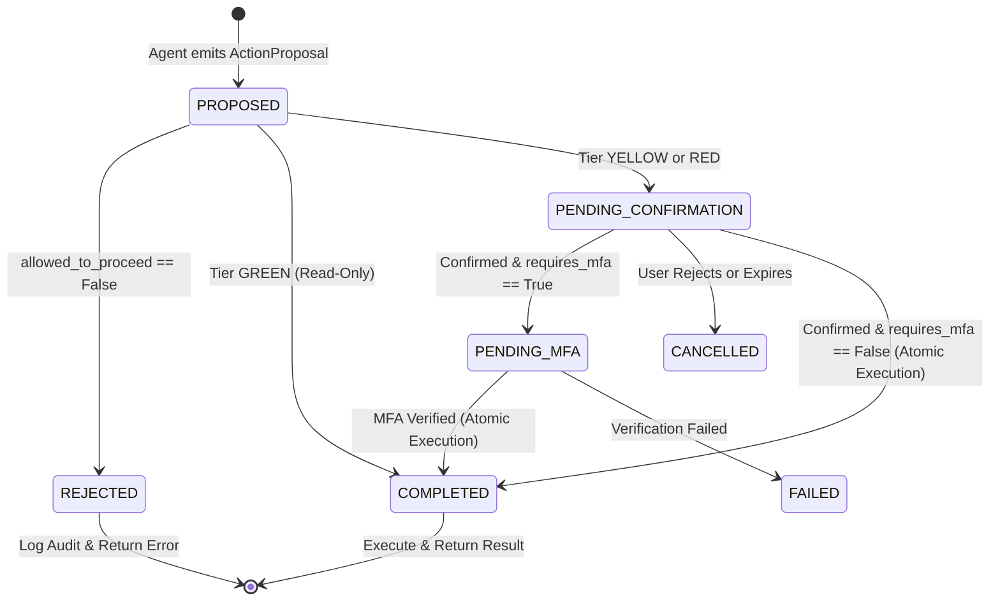

# Integration Guide — Security Policy Module (Person 4)

**Module**: `security.policy`  
**Shared Contracts Version**: 1.0.0  
**Primary Consumer**: Person 2 (Backend Orchestrator)

---

## 1. Quick Start & Public Signatures

To evaluate an agent's proposal against security policies, import and call `evaluate_action`:

```python
from security.policy import evaluate_action
from contracts.models import ActionProposal, BankingContext, PolicyDecision

# Call evaluate_action with the agent's proposal and authenticated backend context
decision: PolicyDecision = evaluate_action(proposal, context)
```

### Signature
```python
def evaluate_action(
    proposal: ActionProposal,
    context: BankingContext,
    config: PolicyConfig = DEFAULT_CONFIG,
) -> PolicyDecision: ...
```

---

## 2. Decision Attributes & Semantics

The returned `PolicyDecision` contains five typed fields:

| Field | Type | Description |
| :--- | :--- | :--- |
| `tier` | `contracts.enums.Tier` | Risk classification: `Tier.GREEN`, `Tier.YELLOW`, or `Tier.RED`. |
| `allowed_to_proceed` | `bool` | `True` if policy permits the action to enter approval/execution workflow; `False` if rejected. |
| `requires_confirmation` | `bool` | `True` if explicit user confirmation is mandatory before execution (Yellow & Red). |
| `requires_mfa` | `bool` | `True` if simulated Multi-Factor Authentication is required (Red). |
| `reason_code` | `str` | Machine-readable explanation for audit logging and client feedback. |

> [!IMPORTANT]
> **`allowed_to_proceed=True` is NOT an execution authorization!**  
> It indicates that the proposal satisfies safety constraints and is permitted to transition into the confirmation or MFA workflow. Actual execution must be performed by the backend after required approvals are verified.

---

## 3. Proposal Lifecycle State Machine (Backend Orchestration)



---

## 4. Backend Implementation Example (Person 2 Integration)

Below is the recommended pattern for how `backend/app/services/orchestrator.py` should invoke and enforce policy decisions:

```python
from decimal import Decimal
from contracts.enums import ActionStatus, Tier
from contracts.models import ActionProposal, BankingContext, ExecutionResult
from security.policy import evaluate_action

def handle_agent_proposal(proposal: ActionProposal, user_session) -> dict:
    # 1. Build authenticated banking context (NEVER accept user_id from client/LLM)
    context = BankingContext(
        user_id=user_session.user_id,
        account_id=user_session.account_id,
        daily_transfer_total=user_session.get_daily_transfer_total(),
        account_balance=user_session.get_account_balance(),
        account_locked=user_session.is_account_locked(),
    )

    # 2. Evaluate security policy (Pure, Fail-Closed)
    decision = evaluate_action(proposal, context)

    # 3. Check for policy rejection (Fail-Closed)
    if not decision.allowed_to_proceed:
        audit_service.log_rejection(proposal, decision.reason_code)
        return {
            "status": ActionStatus.REJECTED,
            "message": f"Action rejected by security policy: {decision.reason_code}",
        }

    # 4. Handle Read-Only Actions (Tier GREEN)
    if decision.tier == Tier.GREEN:
        result = execution_service.execute_read_only(proposal, context)
        return {"status": ActionStatus.COMPLETED, "result": result}

    # 5. Handle State-Changing Mutations (Tier YELLOW & RED)
    # Generate server-issued action ID and cryptographic payload digest
    pending_action = approval_service.create_pending_action(
        proposal=proposal,
        tier=decision.tier,
        requires_mfa=decision.requires_mfa,
    )

    audit_service.log_action_proposed(pending_action, decision)

    return {
        "status": ActionStatus.PENDING_CONFIRMATION,
        "action_id": pending_action.action_id,
        "action_digest": pending_action.action_digest,
        "requires_mfa": decision.requires_mfa,
        "reason_code": decision.reason_code,
    }
```

---

## 5. Configuration & Customization

Policy thresholds can be customized using `PolicyConfig` without modifying frozen contracts:

```python
from decimal import Decimal
from security.rules import PolicyConfig
from security.policy import evaluate_action

# Define custom policy configuration
enterprise_config = PolicyConfig(
    daily_transfer_threshold=Decimal("5000.00"),  # Increase daily limit before MFA
    supported_currency="CNY",
    lock_denies_read_only=True,                   # Block read-only queries on locked accounts
    enforce_account_matching=True,                # Enforce strict tenancy
)

decision = evaluate_action(proposal, context, config=enterprise_config)
```

---

## 6. Standard Reason Codes

| Reason Code | Category | Meaning |
| :--- | :--- | :--- |
| `READ_ONLY_ACCESS` | Approval | Read-only tool permitted without confirmation. |
| `TRANSFER_WITHIN_DAILY_LIMIT` | Approval | Transfer within daily limit ($\le \text{CNY } 1,000$); explicit confirmation required. |
| `TRANSFER_EXCEEDS_DAILY_LIMIT` | Approval | Transfer exceeds daily limit ($> \text{CNY } 1,000$); explicit confirmation and MFA required. |
| `SUBSCRIPTION_CANCEL_CONFIRMATION_REQUIRED` | Approval | Subscription cancellation permitted; explicit confirmation required. |
| `ACCOUNT_LOCKED` | Rejection | Account is locked; state mutation denied. |
| `SOURCE_ACCOUNT_MISMATCH` | Rejection | Proposal source account does not match authenticated context account. |
| `ACCOUNT_MISMATCH` | Rejection | Query target account does not match authenticated context account. |
| `INVALID_TOOL_ARGUMENTS` | Rejection | Tool arguments failed contract validation (e.g. negative amount, extra fields). |
| `UNKNOWN_TOOL` | Rejection | Tool name not recognized in whitelist. |
| `INVALID_PROPOSAL` | Rejection | Proposal object is missing, null, or wrong type. |
| `INVALID_CONTEXT` | Rejection | Context object is missing, null, or wrong type. |
| `INTERNAL_POLICY_ERROR` | Rejection | Unexpected runtime exception caught fail-closed. |
