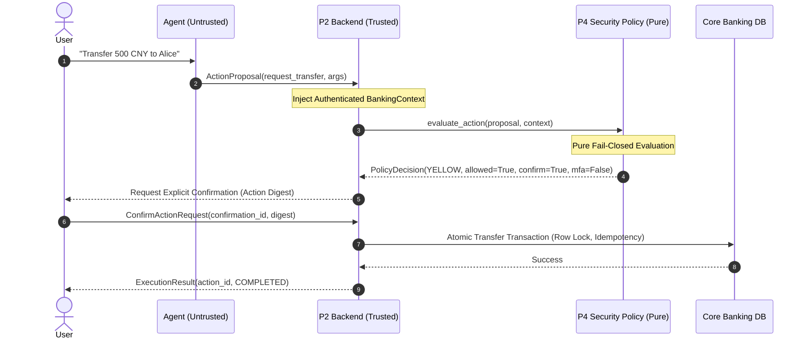

# Security Assessment — AI Banking Agent Policy Engine

**Author**: Person 4 (Finance Risk & Security Engineering)  
**Evaluated Artifact**: `security/policy.py`, `security/rules.py`  
**Shared Contracts Version**: 1.0.0  
**Test Suite**: `security/tests/test_policy.py` (39/39 passing)

---

## 1. Executive Summary

This security assessment reviews the design, implementation, and resilience of the security policy module (`Person 4`). The module serves as the primary authorization barrier between untrusted AI-generated proposals (`ActionProposal`) and state-changing banking operations.

### Key Assessment Findings
* **Verdict**: **PASSED (Production-Ready Architecture)**
* **Fail-Closed Compliance**: **100%**. No execution path allows unauthorized state mutation on invalid, missing, or malformed data.
* **Pure Function Invariant**: **Verified**. Zero side effects, zero I/O, deterministic output, immutable inputs.
* **Test Suite Verification**: **39 comprehensive test cases passed in 0.60s** covering all boundary conditions, injection payloads, account lockouts, and contract conformance.

---

## 2. Security Tier Taxonomy & Risk Policy

The policy engine categorizes every incoming proposal into one of three distinct security tiers:

| Tier | Classification | Conditions & Scope | Required Authorization | Reason Codes |
| :--- | :--- | :--- | :--- | :--- |
| **GREEN** | Low Risk / Read-Only | Queries that do not mutate banking state: `get_balance`, `analyze_spending`, `list_subscriptions`. | Automatic execution; no user confirmation or MFA required. | `READ_ONLY_ACCESS` |
| **YELLOW** | Standard Risk / Explicit Approval | State mutations within standard limits: 1) Transfers with cumulative daily total $\le \text{CNY } 1,000.00$; 2) Subscription cancellations. | Explicit user confirmation required (`requires_confirmation=True`); no MFA. | `TRANSFER_WITHIN_DAILY_LIMIT`<br>`SUBSCRIPTION_CANCEL_CONFIRMATION_REQUIRED` |
| **RED** | High Risk / Strong Verification | State mutations exceeding standard thresholds: Transfers with cumulative daily total $> \text{CNY } 1,000.00$. | Explicit user confirmation AND multi-factor authentication (`requires_confirmation=True`, `requires_mfa=True`). | `TRANSFER_EXCEEDS_DAILY_LIMIT` |
| **RED (Rejection)** | Policy Violation / Attack / Malformed | Locked accounts, tenancy mismatch, schema validation errors, unknown tools, or malformed payloads. | **BLOCKED** (`allowed_to_proceed=False`). Neither confirmation nor MFA is granted. | `ACCOUNT_LOCKED`<br>`SOURCE_ACCOUNT_MISMATCH`<br>`ACCOUNT_MISMATCH`<br>`INVALID_TOOL_ARGUMENTS`<br>`UNKNOWN_TOOL`<br>`INVALID_PROPOSAL`<br>`INVALID_CONTEXT` |

---

## 3. Mathematical Thresholds & Boundary Verification

The daily transfer threshold is evaluated against the cumulative sum:
$$\text{Projected Daily Total} = \text{Context.daily\_transfer\_total} + \text{Proposal.amount}$$

### Exact Boundary Testing
* **$\text{Total} \le \text{CNY } 1,000.00$**: Evaluates to `Tier.YELLOW` (`requires_confirmation=True`, `requires_mfa=False`).
  - Example 1: `amount = 1000.00`, `daily_transfer_total = 0.00` $\implies$ **YELLOW**
  - Example 2: `amount = 500.00`, `daily_transfer_total = 500.00` $\implies$ **YELLOW**
  - Example 3: `amount = 0.01`, `daily_transfer_total = 999.99` $\implies$ **YELLOW**
* **$\text{Total} > \text{CNY } 1,000.00$**: Evaluates to `Tier.RED` (`requires_confirmation=True`, `requires_mfa=True`).
  - Example 1: `amount = 1000.01`, `daily_transfer_total = 0.00` $\implies$ **RED (MFA)**
  - Example 2: `amount = 0.02`, `daily_transfer_total = 999.99` $\implies$ **RED (MFA)**
  - Example 3: `amount = 500.00`, `daily_transfer_total = 800.00` (Fixture T03) $\implies$ **RED (MFA)**

Monetary calculations strictly utilize Python `Decimal` objects to prevent binary floating-point representation vulnerabilities.

---

## 4. Defense-in-Depth Layered Architecture



1. **Layer 1: Schema Integrity**: Shared contract models (`StrictModel`) forbid extraneous or ambiguous fields (`extra="forbid"`).
2. **Layer 2: Policy Engine**: P4 deterministic rule evaluation validates arguments, ownership, account lockout, and daily thresholds.
3. **Layer 3: Authenticated Context**: The backend resolves `user_id` and `account_id` from secure session tokens, preventing client-side user spoofing.
4. **Layer 4: Exact-Payload Cryptographic Binding**: Confirmation requests are cryptographically bound to an exact payload digest, preventing parameter substitution between proposal and execution.
5. **Layer 5: Transactional Isolation**: The backend uses atomic database transactions with row-level locks and unique idempotency keys to eliminate double-spend and race condition attacks.

---

## 5. Fail-Closed Guarantees

The policy engine guarantees that **any unknown or unexpected state defaults to safe rejection**:
1. **Unrecognized Tool**: Rejects with `allowed_to_proceed=False` and `UNKNOWN_TOOL`.
2. **Account Lockout**: When `account_locked=True`, any state mutation is immediately rejected with `ACCOUNT_LOCKED`.
3. **Missing or Corrupted Input**: Passing `None` or invalid object types returns a `PolicyDecision` with `allowed_to_proceed=False`.
4. **Unhandled Exceptions**: A top-level exception handler captures unexpected runtime errors, logs the incident, and returns a fail-closed rejection with `INTERNAL_POLICY_ERROR`.

---

## 6. Verification and Test Results

```text
============================= 39 passed in 0.60s ==============================
- Read-only queries (T01): 3 tests (Passed)
- Daily cumulative transfers (T02, T03): 8 tests (Passed)
- Boundary conditions (1000.00 & 1000.01): 4 tests (Passed)
- Subscription cancellation (T07): 1 test (Passed)
- Account lockout enforcement (T11): 4 tests (Passed)
- Tenancy & ownership checks: 2 tests (Passed)
- Invalid/malformed argument validation (T04): 9 tests (Passed)
- Adversarial & prompt injection resistance (T09): 4 tests (Passed)
- Fail-closed error handling & purity: 4 tests (Passed)
```
Target was $\ge 20$ tests. Suite contains 39 tests with 100% pass rate.
